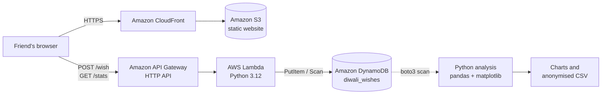

# 🪔 Diwali Cloud Wishes

A serverless Diwali greeting app on AWS. Friends open a link and type their name. The name travels through a live animation of the AWS pipeline, and the page then draws a **one-of-a-kind rangoli generated from that name**, with a personal Diwali and New Year greeting. Every visit is stored in DynamoDB, and a Python script turns the data into charts.

### How the rangoli is generated
1. The name is hashed with **FNV-1a** into a 32-bit seed (shown on the page, e.g. `0x3f9a12c4`).
2. The seed drives a **Mulberry32** pseudo-random generator, so the same name always gives the same rangoli.
3. The generator picks the symmetry (6 to 16-fold), a 4-colour palette and 5 to 7 layers (petals, dots, waves, diamonds, rings).
4. The layers are drawn on an HTML canvas with radial symmetry, with a lit diya in the centre.

The project combines my two areas of study: **cloud engineering** (the serverless backend on AWS) and **data analytics** (collecting, cleaning and visualising the data).

> 🔗 **Live demo:** https://d38q7vq24bkhmm.cloudfront.net

---

## Architecture



| Layer | Service | Why |
|---|---|---|
| Hosting | S3 + CloudFront | Cheap, fast static hosting with HTTPS |
| API | API Gateway (HTTP API) | Simple REST endpoints with CORS |
| Compute | Lambda (Python) | No server to manage; pay per request |
| Storage | DynamoDB (on-demand) | Serverless NoSQL; scales to zero |
| Security | IAM least-privilege policy | Lambda can only `PutItem` and `Scan` on one table |
| Analytics | pandas, matplotlib | Summary statistics and charts |

---

## Repository structure

```
diwali-cloud-wishes/
├── frontend/
│   ├── index.html                 # Greeting page (HTML, CSS, JavaScript)
│   └── assets/                    # Greeting illustration
├── backend/
│   └── lambda_function.py         # Lambda handler: POST /wish, GET /stats
├── infra/
│   └── lambda-dynamodb-policy.json  # Least-privilege IAM policy
├── analysis/
│   └── analyse_wishes.py          # Data analysis and charts
└── README.md
```

---

## API

| Method | Route | Body | Response |
|---|---|---|---|
| `POST` | `/wish` | `{"name": "Priya", "city": "London"}` | `201 {"message": "Wish deployed", "wish_id": "..."}` |
| `GET` | `/stats` | — | `200 {"total_wishes": 12, "top_cities": [...]}` |

`/stats` returns **counts only**. Names are never sent back to the browser.

### Input validation (in Lambda)
- Name is required, maximum 40 characters
- City is optional, maximum 30 characters
- Only letters, spaces, dots, hyphens and apostrophes are accepted

---

## Data model (DynamoDB)

Table: `diwali_wishes` · Partition key: `wish_id` (String) · Capacity: on-demand

| Attribute | Type | Example |
|---|---|---|
| `wish_id` | String (UUID) | `3f2a...` |
| `name` | String | `Priya` |
| `city` | String | `London` |
| `created_at` | String (ISO 8601, UTC) | `2026-11-08T18:42:10+00:00` |
| `hour_utc` | Number | `18` |

---

## Data analysis

```bash
pip install pandas matplotlib boto3
python analysis/analyse_wishes.py --table diwali_wishes --region eu-west-2
```

The script:
1. Reads all items from DynamoDB (handles pagination)
2. Cleans the data (time zone conversion to UK time, city name standardisation)
3. Prints a summary: total wishes, unique cities, busiest hour
4. Saves three charts to `analysis/output/`: wishes by city, by hour, and cumulative over time
5. Exports an **anonymised CSV** (names removed) for sharing

### Results

_Add your charts and findings here after collecting data._

---

## Privacy

- Only a first name and an optional city are collected, and the form tells visitors this before they submit.
- No emails, phone numbers or IP addresses are stored.
- The public `/stats` endpoint returns aggregated counts only.
- Shared exports have names removed.
- Data will be deleted after the analysis is complete.

---

## Deployment (summary)

1. Create the DynamoDB table `diwali_wishes` (partition key `wish_id`, on-demand).
2. Create the Lambda function from `backend/lambda_function.py` and set the environment variable `TABLE_NAME=diwali_wishes`.
3. Attach the IAM policy in `infra/` to the Lambda execution role.
4. Create an API Gateway HTTP API with routes `POST /wish` and `GET /stats`, integrated with the Lambda, and enable CORS.
5. Paste the API URL into `API_URL` at the bottom of `frontend/index.html`.
6. Upload `index.html` to an S3 bucket and serve it through CloudFront.

---

## What I learned

_To be completed after deployment._

---

## Cost

Designed to stay within the AWS Free Tier for small personal use: Lambda and API Gateway are charged per request, and DynamoDB on-demand charges only for the reads and writes made.

---

Built by **Janvi Patel** · MSc Applied Data Science, University of Essex
